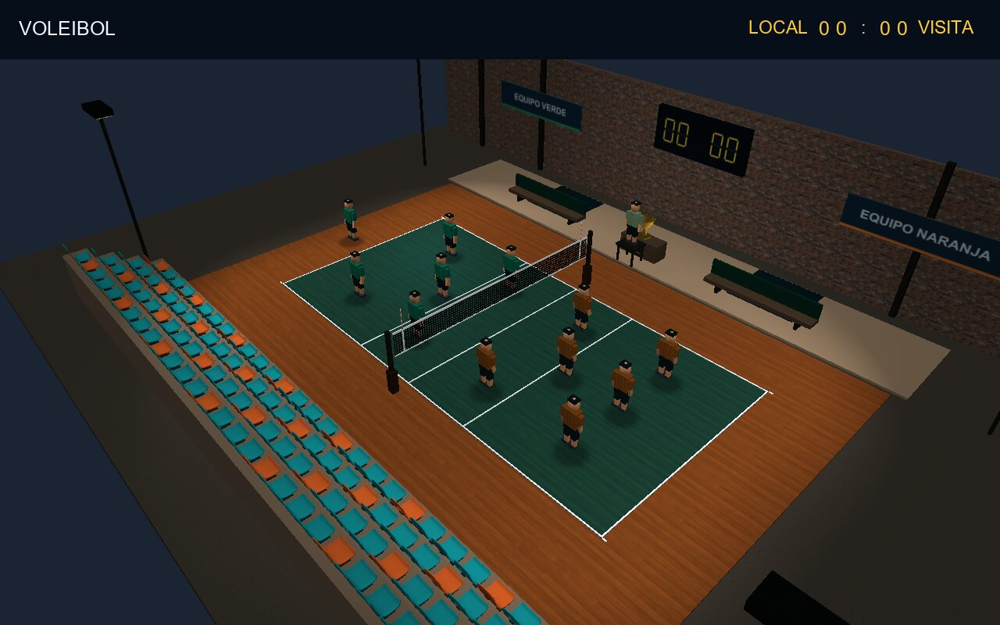
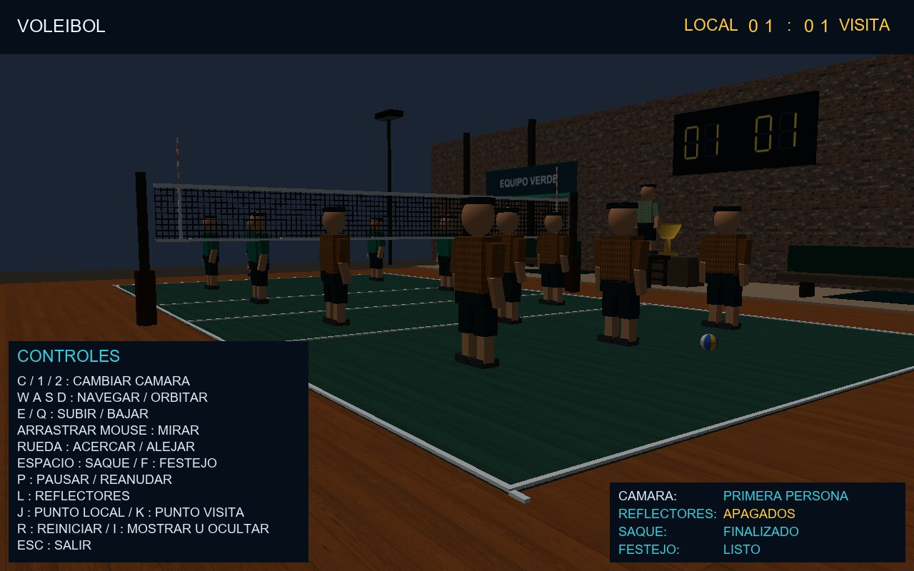

# Voleibol de sala varonil

Proyecto final del Laboratorio de Computación Gráfica e Interacción Humano Computadora
(Facultad de Ingeniería, UNAM), grupo de laboratorio 09, semestre 2027-1.

Escenario 3D interactivo de un gimnasio de voleibol hecho en C++ con OpenGL 3.3. Se puede
recorrer el gimnasio en primera persona o con una cámara orbital tipo transmisión, lanzar un
saque animado con cuadros clave, encender o apagar los reflectores, modificar el marcador y
activar el festejo del trofeo.

## Contenido del escenario

- **Cancha reglamentaria FIVB:** 18 × 9 m, líneas de 5 cm, líneas de ataque a 3 m y red a 2.43 m.
- **Tres zonas:** cancha y zona libre, bancas y calentamiento, y gradas para espectadores.
- **Doce jugadores y un árbitro** construidos con modelado jerárquico: raíz, hombros, brazos,
  antebrazos, caderas, rodillas y zapatos.
- **Modelos OBJ cargados con Assimp:** trofeo, butaca (repetida en las gradas) y balón.
- **Texturas:** duela, ladrillo, concreto, tela, metal, goma, madera, red, balón y letreros.
- **Iluminación:** luz direccional y cuatro reflectores con cono y atenuación (Phong), y sombras simuladas.
- **Animaciones:** saque con ocho cuadros clave interpolados, y cambio de escala del trofeo.
- **Interfaz:** marcador, panel de controles y panel de estado.

## Requisitos

- Windows con soporte de OpenGL 3.3.
- Para compilar: Visual Studio con *Desarrollo para el escritorio con C++*, MSVC v143 y Windows SDK.
  En Visual Studio 2026, v143 se instala como componente adicional.

Las bibliotecas (GLEW, GLFW, GLM, Assimp y SOIL2) ya vienen compiladas para 32 bits en
`External Libraries`. No hace falta instalar nada más.

## ¿Cómo ejecutarlo?

**Sin compilar:** clonar o descargar el repositorio (*Code → Download ZIP*) y abrir `Voleibol.exe`.
Debe quedarse junto a la carpeta `configbase` y a las DLL.

**Desde Visual Studio:**

1. Abrir `Voleibol.sln`.
2. Seleccionar **Debug** o **Release** y **x86**.
3. Pulsar **Ctrl + F5**.

## Controles

| Tecla | Acción |
|---|---|
| `C` / `1` / `2` | Alternar cámara / primera persona / orbital |
| `W` `A` `S` `D` | Recorrer en primera persona; acercar, alejar o girar en orbital |
| `E` / `Q` | Subir o bajar; inclinar en orbital |
| Arrastrar el mouse | Orientar la vista |
| Rueda del mouse | Acercar o alejar la cámara orbital |
| `Espacio` | Saque |
| `F` | Festejo del trofeo (animación de escala) |
| `P` | Pausar o reanudar la animación |
| `L` | Encender o apagar reflectores y sombras |
| `J` / `K` | Sumar punto al local / al visitante |
| `I` | Mostrar u ocultar los paneles |
| `R` | Reiniciar |
| `Esc` | Salir |

## Equipo

| Integrante | Rol técnico |
|---|---|
| Jonathan Alonso Reyes Amaya | Líder de Escenario y Geometría |
| Martha Selene Galván Castro | Líder de Modelado Jerárquico y Animación |
| Alejandra Melissa Saucedo Serralde | Líder de Pipeline Gráfico, Shaders e Iluminación |

Metodología de trabajo: Kanban.

## Créditos

- Texturas de materiales: [Poly Haven](https://polyhaven.com/license) (CC0). Las fuentes de cada
  imagen están en `configbase/Textures/Fuentes.json`.
- Medidas de la cancha: [Reglas oficiales de voleibol FIVB 2025–2028](https://www.fivb.com/volleyball/the-game/official-volleyball-rules/).
- Base del código: prácticas del laboratorio ([JhonnyFeik/CGIH-FI](https://github.com/JhonnyFeik/CGIH-FI),
  [MartSelene/Lab_Grafica](https://github.com/MartSelene/Lab_Grafica) y
  [mel-blip/LabCompuGrafica](https://github.com/mel-blip/LabCompuGrafica)) y
  [LearnOpenGL](https://learnopengl.com/).
- Las licencias de las bibliotecas están en `External Libraries/Licencias`.
